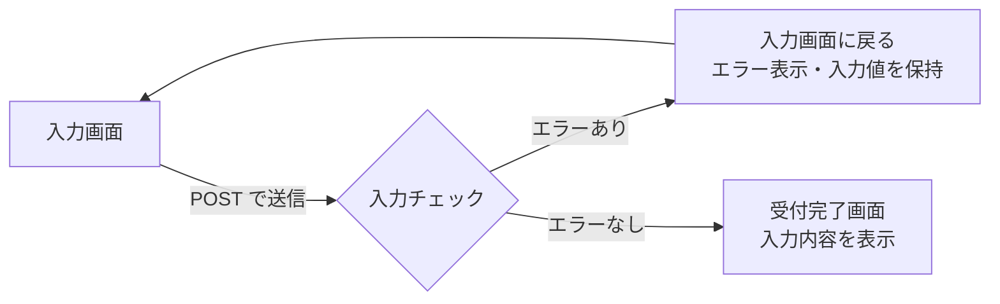

<div align="center">

# 📮 お問い合わせフォーム

PHP で作成した、入力チェック付きのお問い合わせフォームです。


</div>

---

## 📑 目次

- [📝 概要](#-概要)
- [🚀 動かし方](#-動かし方)
- [💡 工夫した点](#-工夫した点)
- [📚 学んだこと](#-学んだこと)

---

## 📝 概要

`contact.php` **1ファイルだけ**で、入力画面・エラー表示・受付完了画面を切り替えています。

### 入力項目とチェック内容

| 項目 | 必須 | チェック内容 |
| :--- | :---: | :--- |
| 👤 名前 | ✅ | 50文字以内 |
| ✉️ メールアドレス | ✅ | メールアドレスの形式（`FILTER_VALIDATE_EMAIL`） |
| 🏷️ 件名 | ✅ | 100文字以内 |
| 💬 メッセージ | ✅ | 1000文字以内 |

### 画面の流れ



> [!NOTE]
> 学習用のため、実際のメール送信やデータ保存は行っていません。

---

## 🚀 動かし方

```bash
cd month1/week3/contact
php -S localhost:8000
```

ブラウザで **http://localhost:8000/contact.php** を開きます。

---

## 💡 工夫した点

### 1. 🛡️ XSS 対策

画面に出力する値は、すべてエスケープ用の関数 `h()` を通しています。

```php
function h($str) {
    return htmlspecialchars($str, ENT_QUOTES, "UTF-8");
}
```

完了画面だけでなく、次の箇所でもエスケープしています。

- [x] 受付完了画面に表示する入力内容
- [x] エラー時に `value` 属性へ戻す入力値
- [x] エラー時に `textarea` へ戻す入力値
- [x] エラーメッセージ

### 2. 🈳 空白だけの入力を弾く

`trim()` は**全角スペースを取り除かない**ため、正規表現で「空白だけの入力」を空文字として扱い、必須チェックをすり抜けないようにしました。

```php
if (preg_match("/\A\s*\z/u", $name)) { $name = ""; }
```

### 3. 🔢 日本語の文字数を正しく数える

`strlen()` はバイト数を数えるため、日本語だと文字数がずれてしまいます。
`mbstring` 拡張がない環境でも動くよう、正規表現で1文字ずつ数える関数を作りました。

```php
function str_length($str) {
    return preg_match_all("/./us", $str);
}
```

### 4. ⚠️ 送られてこなかった項目でエラーにならないようにする

null 合体演算子 `??` を使い、項目がなくても警告が出ないようにしました。

```php
$name = trim($_POST["name"] ?? "");
```

### 5. ✨ 使いやすさ

- エラー時は**入力値を保持**して、再入力の手間を減らしました
- エラーメッセージは**該当項目のすぐ下**に表示しました
- 必須項目には <kbd>必須</kbd> ラベルを付けました

### 6. 🧪 サーバー側のチェックを確かめられるようにする

`<form novalidate>` でブラウザの入力チェックを無効にし、PHP 側のチェックが確実に動くことを確認できるようにしました。

---

## 📚 学んだこと

> [!IMPORTANT]
> ブラウザ側のチェックは簡単に回避できるため、**入力チェックはサーバー側でも必ず行う**。

> [!WARNING]
> ユーザーの入力をそのまま画面に出すと XSS の危険がある。**出力するときにエスケープする**のが基本。

<details>
<summary><b>🔍 そのほかに学んだこと（クリックで開く）</b></summary>

<br>

| テーマ | 学んだこと |
| :--- | :--- |
| 処理の分け方 | `$_SERVER["REQUEST_METHOD"]` で、初回表示と送信後の処理を1ファイルの中で分けられる |
| 日本語の扱い | `trim()` は全角スペースを消さない／`strlen()` はバイト数を数える |
| テンプレートの書き方 | `<?php if (...): ?> ... <?php endif; ?>` で、HTML の中の条件分岐を読みやすく書ける |
| `textarea` | `value` 属性ではなく、タグの間に値を入れる |

</details>
